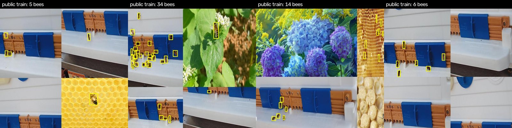
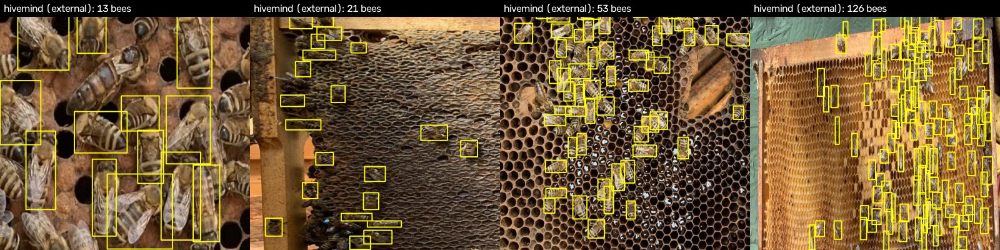
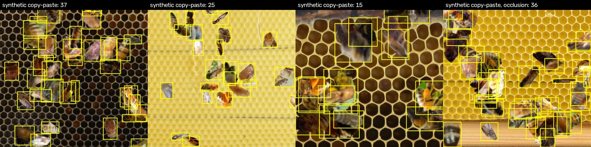
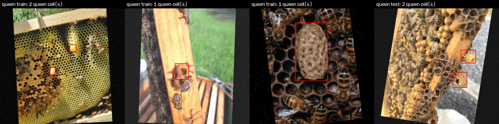
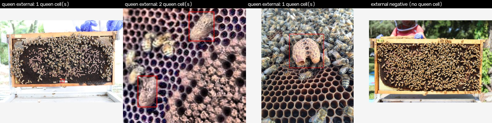
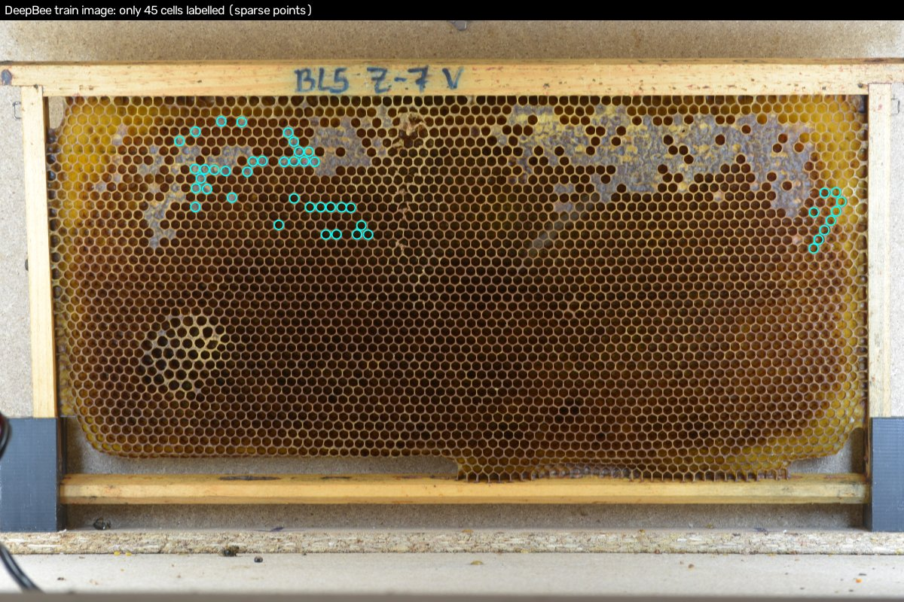
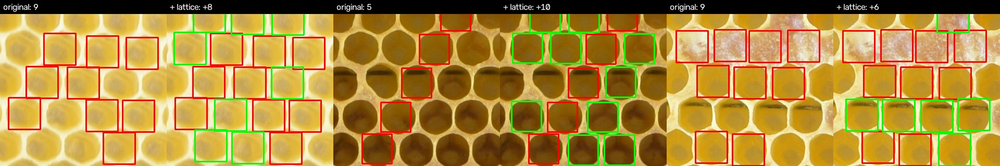
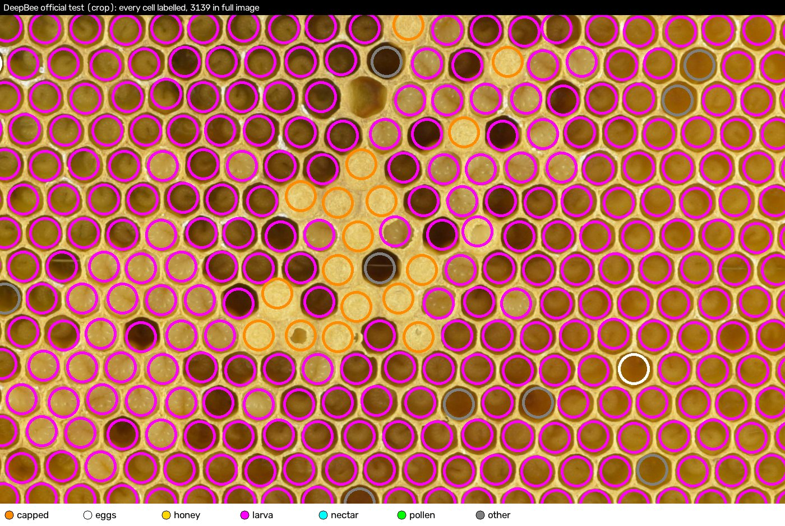
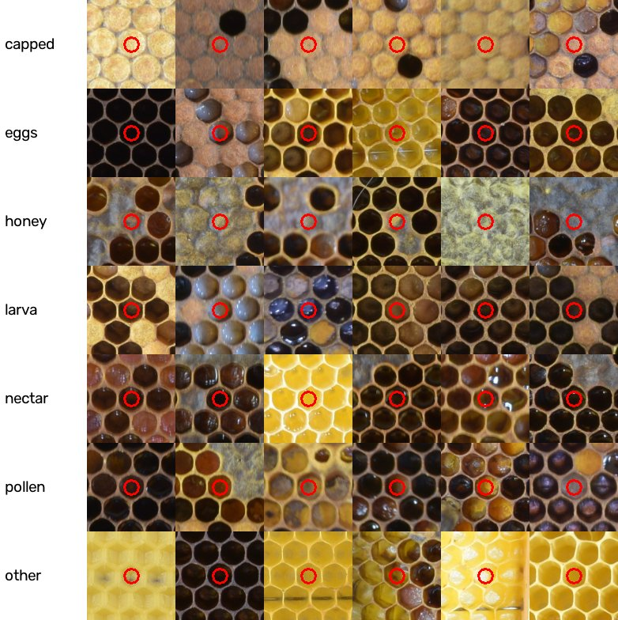

# 数据集介绍

2026-10-23

本研究的多任务模型同时完成四个任务：蜜蜂检测、王台检测、巢房定位、巢房内容分类（7 类）。下面介绍每个任务用到的训练集、验证集和测试集，并给出样例图。样例图中的框和圈都是数据集自带的真值标注，不是模型预测。

[← 返回实验汇报](README.md) · [总进度与待办](progress.md)

## 一、总览

| 任务 | 训练集 | 验证集 | 内部测试集 | 外部测试集（从未参与训练） |
|---|---|---|---|---|
| 蜜蜂检测 | 1,718 张 / 28,288 只 + 复制粘贴合成 2,000 张 | 156 张 / 1,809 只 | —（无同源独立测试集） | hivemind：199 张 / 5,134 只 |
| 王台检测 | 1,037 张 / 2,245 个 + 负样本 428 张 | 176 张 / 355 个 + 负样本 92 张 | 98 张 / 205 个 | 5 个项目 152 张 / 343 个 + 负样本 600 张 |
| 巢房定位 | DeepBee 切片 700 块（320×320） 每块平均标注 9.9 个，补全后 16.2 个 | 150 块 | — | DeepBee 官方测试集 10 张 / 30,133 个巢房（全标注） |
| 巢房内容分类 | 58,646 个图块（7 类） | 13,223 个图块 | — | 同上 10 张图的 30,133 个巢房（给定真实位置分类） |

评测指标：
- 蜜蜂、王台：AP50（每图最多 300 个检测）；P/R 取置信度 0.25。
- 巢房定位：中心点匹配（距离 ≤ 0.7 倍巢房半径）的 P / R / F1。
- 内容分类：准确率和 7 类宏平均召回。

## 二、蜜蜂检测

### 训练集与验证集：Roboflow honey-bees-detection

来源 [honey-bees-detection](https://universe.roboflow.com/multimedije/honey-bees-detection)（CC BY 4.0）。训练集 1,718 张，验证集 156 张。场景以蜂箱巢门为主，另有花朵、巢脾上的少量蜜蜂，部分图片是 Roboflow 导出时生成的 4 宫格拼图。

**特点：**
- **场景偏向巢门和花朵**，蜜蜂小、稀疏。验证集每张图的蜜蜂数中位数只有 1 只，但个别图多达 357 只。
- 巢脾上密集、相互遮挡的蜜蜂在训练集中很少，而这恰恰是蜂箱巡检的目标场景，因此另外构建了合成数据（第三节）。

### 外部测试集：hivemind

来源 [hivemind](https://universe.roboflow.com/ultrakill-detect/hivemind-6qas2)（CC BY 4.0）。199 张，5,134 只蜜蜂，每图中位数 21 只，最多 126 只（2 张超过 100 只）。全部是巢脾上的蜜蜂，有大量相互遮挡。已用图像哈希与训练集去重：去掉 1 张近似重复，剩余图片与训练集 0 张近似重复。

**已知问题：**
- **标注不全。** 例如上图最左，不少蜜蜂没有框，所以所有模型在这个测试集上的精确率都偏低，但模型间比较仍然公平。
- 遮挡分析按"与其他真值框的最大 IoU"分级：
  - 无遮挡 1,414 只
  - 轻度（0–0.1）1,997 只
  - 中度（0.1–0.3）1,285 只
  - 重度（>0.3）438 只

## 三、AI 扩充数据（蜜蜂）

### 复制粘贴合成（采用）

从蜜蜂训练集的标注框里用 GrabCut 抠出 517 只蜜蜂（来自 372 张图），过滤分割失败、偏色、被图像边界截断的抠图。然后随机贴到 DeepBee **训练集**巢脾照片（1,202 张）上：

- 每图贴 8–45 只。
- 随机旋转、翻转、缩放（蜂长约 2.8 个巢房直径）和调节亮度。
- 后贴的遮挡先贴的。
- 可见面积不足 40% 的蜜蜂不标注，但仍留在图中。

共 2,000 张，平均每图标注 23.1 只。生成过程不读取任何测试图片。训练时每个蜜蜂样本以 p=0.5 的概率取自合成集。

遮挡版（下图最右）每图贴 30–80 只，一半的蜜蜂紧挨已有蜜蜂放置，标注完整框，平均每图标注 34.1 只。实验表明它相对普通版没有显著额外收益。

合成图比较粗糙，部分抠图不完整或带有背景。但实验中它是唯一有效的扩充方式：外部蜜蜂 AP50 从 .525 提高到 .618。

### 扩散模型生成（未采用，负结果）

用 SD-Turbo 按提示词生成密集上脾场景，再用模型自动标注伪标签。图片很逼真，但对外部测试集没有提升，原因是伪标签无法提供新知识。生成图不在本页展示。

## 四、王台检测

### 训练 / 验证 / 测试集

三个 Roboflow 项目合并（均为 CC BY 4.0）：
- [queen-cells-seg](https://universe.roboflow.com/rozu/queen-cells-seg-9d3ht)：训练 888 / 验证 133 / 测试 70 张
- [bees-detection-model-v2](https://universe.roboflow.com/bees-xh9di/bees-detection-model-v2)：129 / 36 / 20 张
- [bees（andrew-hofer）](https://universe.roboflow.com/andrew-hofer-1qh7e/bees-ytrmp)：20 / 7 / 8 张

划分规则：
- Roboflow 对同一原图导出的增强变体被归为同一组，同组只会出现在一个划分里。
- 另合并了 50 组相关系数 ≥ 0.88 的近似图。
- 负样本是 DeepBee 巢脾照片（假定没有王台）和蜜蜂数据中的巢脾帧。

**已知问题：**
- 测试集只有 98 张 / 205 个王台，AP 的抽样误差约 ±0.02–0.03。
- 按 64 位 dHash（汉明距离 ≤ 6）检查，有 **9/98 张测试图与训练图相似**（可能是相似场景，也可能是轻微泄漏）。论文中另报告去掉这 9 张后的结果。
- 图片多为网络照片和特写，与蜂场固定相机拍摄的画面不同。

### 外部测试集

5 个与训练集无关的 Roboflow 项目（均为 CC BY 4.0），共 152 张 / 343 个王台：

| 项目 | 图 | 王台 |
|---|---|---|
| [yolov7-4dcap](https://universe.roboflow.com/beehiveclassificationdataset/yolov7-4dcap) | 60 | 135 |
| [fhashf](https://universe.roboflow.com/inspector/fhashf) | 40 | 74 |
| [queen_detection_v0](https://universe.roboflow.com/sam-gk3pf/queen_detection_v0) | 26 | 82 |
| [hivemind](https://universe.roboflow.com/ultrakill-detect/hivemind-6qas2) | 18 | 42 |
| [hive-inspection](https://universe.roboflow.com/queen-bee-g6nee/hive-inspection) | 8 | 10 |

另有这些项目中不含王台的 600 张蜂箱照片作为负样本，用来统计误检。已去掉与训练数据近似重复的 153 张。

外部集画面差异很大：整框照片里王台很小，也有低分辨率特写。所有模型在这里的 AP50 都只有 0.2–0.4。

## 五、巢房定位与内容分类：DeepBee

来源：Alves et al., *DeepBee*, Computers and Electronics in Agriculture 170 (2020) 105244。代码仓库 [AvsThiago/DeepBee-source](https://github.com/AvsThiago/DeepBee-source)（MIT 许可证），数据由作者公开发布（[DS-COMB-PT](https://cloud.ipb.pt/d/aa29c989ab1944aaa222/?p=/DS-COMB-PT)）。照片在统一的暗箱中拍摄（Nikon D3300，6000×4000）。

### 训练标注稀疏

DeepBee 训练集只给出部分巢房的中心点和类别，每张原图平均约 60 个，而一张巢脾实际有约 3,000 个巢房。下图这张只标了 45 个（青色圈）。

我们把点标注转换成 320×320 切片上的框（每张原图取一块最密的，共 700 块训练、150 块验证）。即便如此，平均每块只有 9.9 个框，而实际约有 24 个巢房，约六成未标注巢房被当作背景。这是 ViT 主干巢房召回低的根本原因。

### 六边形晶格标注补全（本文方法）

巢房呈规则六边形排列。从已标注中心估计格距和方向，沿格点向外生长；候选点附近必须有检测模型的响应（置信度 ≥ 0.01，距离 ≤ 0.35 格距）才接受，并吸附到该检测位置。每块平均补 6.3 个，从 9.9 个增加到 16.2 个，只使用训练集。下图红框为原始标注，绿框为补全的标注。

### 官方测试集（全标注）

DeepBee 官方测试集有 13 张图，**每个巢房都有标注**。其中 3 张出现在训练 / 验证数据里，已排除，剩 10 张、30,133 个巢房。下图是其中一张的局部，颜色表示内容类别。

**已知问题：** 只有 10 张图，并且与训练集同源（同一实验室、同一批蜂箱、同一拍摄装置），没有外部测试集，因此巢房定位和内容分类的结果说明不了模型在其他蜂场的表现。

### 内容分类图块

以巢房中心裁出 7 倍半径的图块（包含周围巢房作为上下文），缩放到 224×224。下图每行一类，红圈为待分类的中心巢房。

训练集各类数量：

| 类别 | 中文 | 训练图块 |
|---|---|---|
| other | 其他（空巢房等） | 13,895 |
| pollen | 花粉 | 11,962 |
| nectar | 花蜜 | 9,550 |
| larva | 幼虫 | 7,307 |
| honey | 蜂蜜 | 6,725 |
| capped | 封盖 | 5,115 |
| eggs | 卵 | 4,092 |

larva 和 nectar 最难区分。训练时按类别频率的 −1/2 次方加权采样，缓解类别不平衡。

## 六、现场数据（未公开）

另有少量自采现场数据：蜜蜂弱标注图 71 张，内容分类裁片训练 198 个、验证 49 个，分别用于辅助训练和参考验证。因为没有公开，本页不展示样例。数量太少，不作为正式测试集。

## 七、数据卫生

- 所有测试集在训练中从未读取。合成数据和标注补全只使用训练集。
- 外部测试集均已与训练数据做近似重复检查：
  - 蜜蜂外部集去掉 1 张，剩余 0 张近似重复。
  - 王台外部集去掉 153 张。
  - 王台内部测试集有 9/98 张相似，单独报告。
- DeepBee 官方测试集排除了出现在训练 / 验证中的 3 张。

## 八、许可证与致谢

- Roboflow Universe 各项目均为 CC BY 4.0，作者见上文链接。
- DeepBee：Alves, T. S., Pinto, M. A., Ventura, P., Neves, C. J., Biron, D. G., Junior, A. C., De Paula Filho, P. L., Rodrigues, P. J. (2020). Automatic detection and classification of honey bee comb cells using deep learning. *Computers and Electronics in Agriculture*, 170, 105244。代码为 MIT 许可证，数据由作者公开发布。
- 本页样例图由上述公开数据缩放、裁剪并叠加标注绘制而成；合成图使用了上述两类数据。
